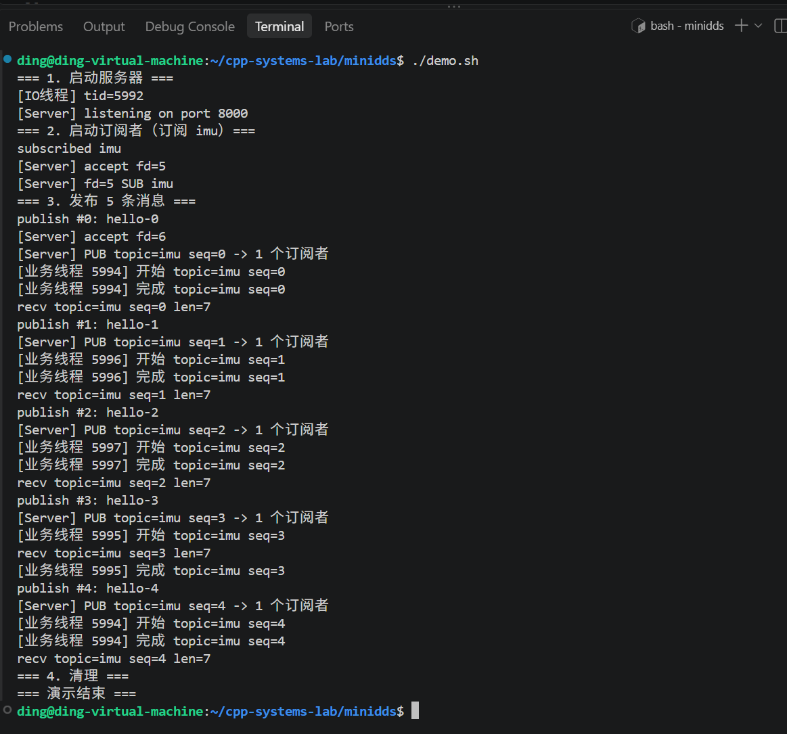

# MiniDDS

自己写的一个发布订阅中间件：客户端之间不直接连，只往 topic 上发消息，服务器按订阅关系转发。
TCP + epoll + Reactor，消息体 Protobuf，帧头 4 字节长度前缀。

写它主要是为了把「中间件在干什么」亲手走一遍：epoll 怎么管连接、粘包怎么切、订阅表怎么维护、
短写和慢收端怎么处理。网络层（epoll / Reactor / 分帧 / 线程池）都是自己写的，没套 muduo
这类现成框架，序列化用的 protobuf。
项目用于学习发布订阅通信机制，采用自定义 TCP 协议，未实现 DDS/RTPS 标准兼容。

## 快速开始

```bash
mkdir -p build && cd build
cmake .. && make -j4
```

编译完产物在 `build/` 下。开三个终端，**都先 cd 到 `build/` 目录**：

```bash
./minidds_server 8000   # 终端 1：起服务器
./subscriber 8000 imu   # 终端 2：订阅 imu
./publisher 8000 imu 5  # 终端 3：发布 5 条
```

`./demo.sh` 一键演示：起 server + subscriber + publisher 三进程，能看到订阅表查表转发、业务线程池（tid 在变）以及订阅者收到消息。



## 特性

- epoll + Reactor，IO 线程只有一个，不需要给缓冲加锁
- 4 字节长度前缀分帧，粘包半包都在 Codec 里切
- SUB / UNSUB / PUB，一个连接可以同时订阅多个 topic
- protobuf oneof 区分一帧装的是控制消息还是数据消息（proto3 普通字段没有 has_，枚举默认值会误判）
- 写缓冲没发完就挂上 EPOLLOUT，发空了再摘掉
- 固定线程数的线程池跑业务回调

## 架构

8 个模块，一条消息从进来到转发出去走这一路：

```
                 ┌─────────────┐
   客户端 TCP ──►│  EventLoop  │   单 IO 线程，主循环
                 │             │
                 └──────┬──────┘
                        │ epoll_wait
                 ┌──────▼──────┐
                 │   Epoller   │   epoll 三件套封装
                 └──────┬──────┘
                        │
                 ┌──────▼──────┐        ┌──────────────┐
                 │   Channel   │◄──────►│     Codec    │
                 │  fd+事件+回调 │        │ 4字节长度前缀  │
                 └──────┬──────┘        └──────────────┘
                        │
                 ┌──────▼──────┐
                 │ Connection  │   读缓冲 + 写缓冲 + 订阅集合
                 └──────┬──────┘
                        │
                 ┌──────▼────────┐
                 │ TopicRegistry │   topic → 订阅连接集合
                 └──────┬────────┘
                        │
                 ┌──────▼──────┐
                 │  ThreadPool  │   业务回调线程
                 └─────────────┘
```

收到帧之后分两类：控制帧（SUB / UNSUB）改订阅表，数据帧（PUB）查订阅表再逐个 send。

几个约定：

- 一条连接 = fd + 读缓冲 + 写缓冲 + 它订阅的 topic 集合
- 缓冲区和 Channel 只在 IO 线程里碰，别的线程不碰
- 业务回调丢进线程池，不占 IO 线程

## 测试

单测手工编译，在仓库根目录跑：

```bash
g++ -std=c++17 -Iinclude tests/test_codec.cc src/Codec.cc -o build/test_codec && ./build/test_codec
```

- `test_codec.cc`：单帧、半包、粘包、超长帧拒绝，全用 assert
- `proto_test.cc`：序列化往返、oneof 判定、乱字节不误判
- `topic_test.cc`：重复订阅去重、removeConnection 一次清掉所有 topic
- `stress_multi.sh`：并发压测
- `leak_check.py`：连断 N 次，采样 RSS 和 fd 数

并发压测（./stress_multi.sh 40 10 10，40 订阅者 + 10 发布者）：每个订阅者应收 10×10=100 条，实测 40 个全是 100、共 4000 条没漏；杀掉一半订阅者再补发一条探针，服务器记的订阅数正确掉到 20，没崩。

10MB 大包验短写：一次 send 发不完，strace 里能看到 4 次 sendto，剩下的留在写缓冲等 EPOLLOUT。

## 性能

下表数据均在零订阅者条件下测得，表示服务器接收并处理发布消息的吞吐，不代表订阅者端到端接收吞吐。

`examples/bench.cc` 单连接连发，payload 1 字节（"x"），本机 loopback。bench 不在 CMake 里，手工编译：

```bash
g++ -std=c++17 -O2 -Iinclude -Ibuild examples/bench.cc src/Codec.cc build/message.pb.cc -o build/bench -lprotobuf
```

QPS = 总条数 ÷ 耗时：

| 条数 | bench 发送端 QPS | server 处理 QPS |
|---|---|---|
| 1000 | 100 万 | 9 万 |
| 20000 | 125 万 | 25 万 |
| 100000 | 128 万 | 38 万 |

server 的 QPS 是「处理总条数 ÷ 计时」：从第一条发出开始，到日志里 `PUB topic=bench` 的条数够 N 条为止。压测时 `top -H` 显示 IO 线程 99.9%、四个业务线程 0.0%——吞吐上限由单个 IO 线程决定，带转发的实际数字会更低。

## 已知限制

- 不存历史消息，订阅者得先连上再发，先发后订的那条会丢
- 业务回调现在只打印 tid，没有真实业务（线程解耦的机制已就位，但还没拿真实慢业务压过）
- 压测只数条数，验不了消息有没有串到别的 topic
- 只测了吞吐，延迟和 P99 没测（协议没有回执，测延迟得另加 ack）
- 压测都在本机 loopback，跨机器没测过
- 没有空闲连接超时，也没有鉴权
- IO 只有一个线程，连接数上去了要拆成多线程

## 目录

```
minidds/
├─ proto/      消息定义
├─ include/    头文件
├─ src/        实现 + main
├─ examples/   publisher / subscriber / bench
├─ tests/      单元测试 + 压测脚本
├─ demo.sh     一键演示
└─ docs/       README 截图
```
